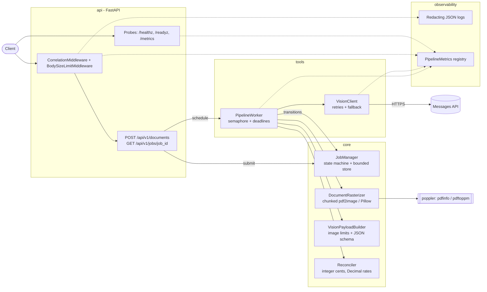
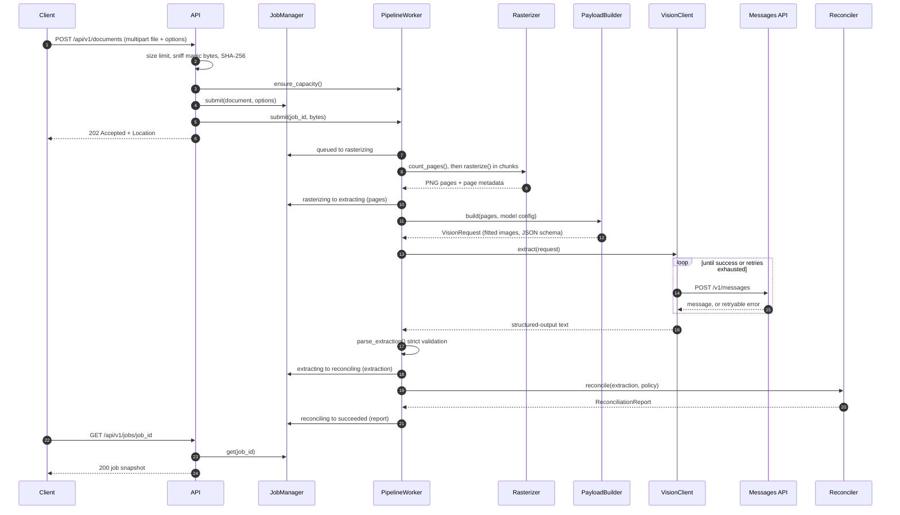
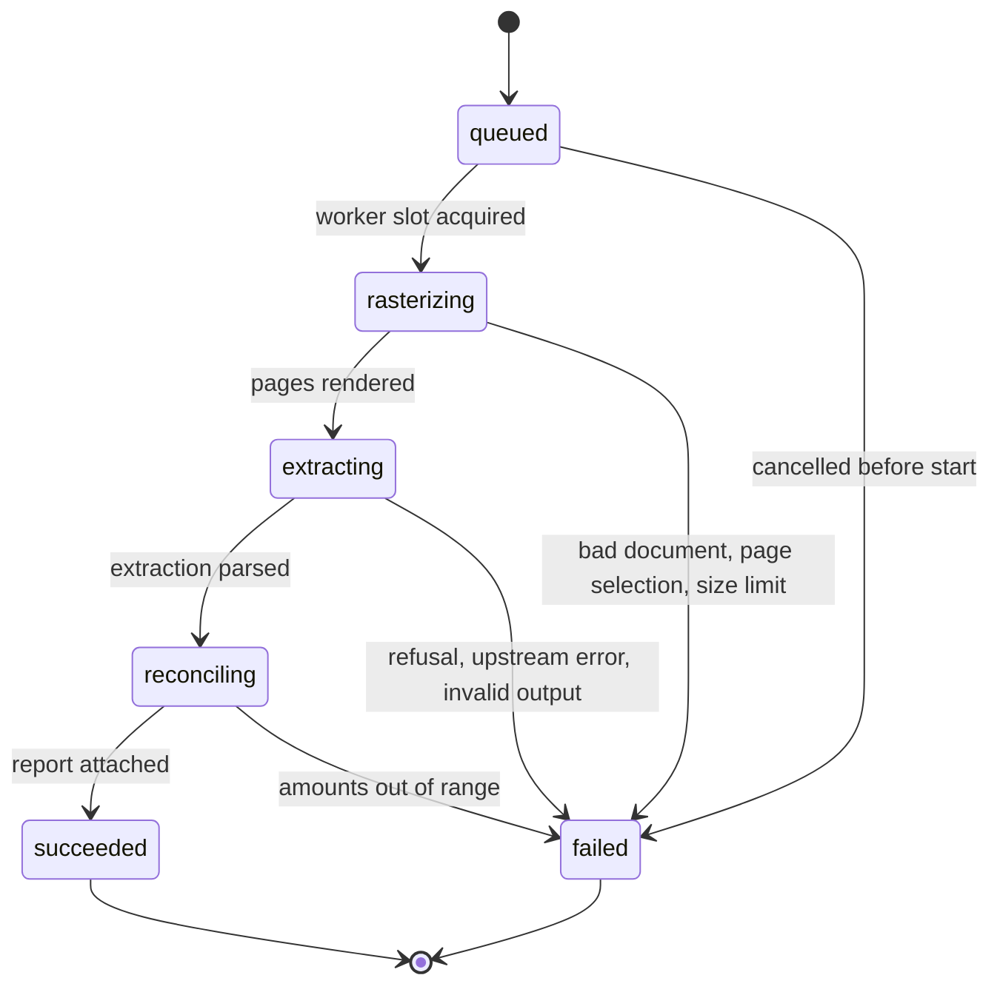
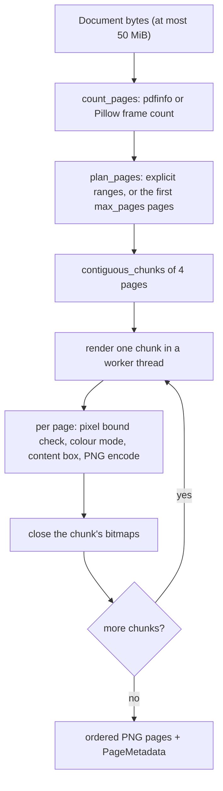

# Architecture

`multimodal-vision-pipeline` turns uploaded business documents into validated, structured data.
It is a single FastAPI process with an in-process asynchronous worker: no database, no broker,
no shared state outside the process. This guide describes the components, the data flow, the
job lifecycle, the arithmetic rules and the memory model, including the limits and the reasons
for them.

- [Components](#components)
- [Request and data flow](#request-and-data-flow)
- [Job lifecycle](#job-lifecycle)
- [Ingestion](#ingestion)
- [Rasterization and memory bounds](#rasterization-and-memory-bounds)
- [Vision payload builder](#vision-payload-builder)
- [Resilient vision client](#resilient-vision-client)
- [Mathematical reconciliation](#mathematical-reconciliation)
- [Error model](#error-model)
- [Observability](#observability)
- [Concurrency, deadlines and shutdown](#concurrency-deadlines-and-shutdown)
- [Security posture](#security-posture)
- [Trade-offs and known limits](#trade-offs-and-known-limits)

## Components

| Package | Responsibility |
|---|---|
| `api` | App factory and lifespan, multipart ingestion, job polling, probes, problem handlers. |
| `core.job_manager` | Thread-safe job store, legal transitions, idempotency keys, eviction. |
| `core.rasterizer` | Page counting, page planning, chunked rendering, DPI and pixel bounds, PNG encoding. |
| `core.vision_builder` | Per-model image fitting, token budget, request body, strict response parsing. |
| `core.reconciler` | The five arithmetic rules, exact and deterministic. |
| `tools.vision_client` | Raw `httpx` Messages API client: retries, timeouts, refusals, error mapping. |
| `tools.pipeline_worker` | Runs jobs through the stages under a concurrency limit and a deadline. |
| `observability` | Correlation context, JSON log formatter with redaction, Prometheus metrics, access logs. |
| `schemas` | Strict, frozen Pydantic contracts shared by every layer; `VisionSettings`. |
| `evals` | Offline accuracy benchmarks on synthetic, degraded documents. |

## Request and data flow

The HTTP request ends at `202`; everything after it happens in the worker. Pages leave the
rasterizer as PNG bytes and are re-encoded once by the payload builder; the builder's request is
then the only copy of the page images.

Telemetry is a side channel of every step: each stage is timed into
`mvp_job_duration_seconds{stage}`, each API attempt into `mvp_upstream_requests_total` and
`mvp_upstream_latency_seconds`, and every log line carries the request's correlation id and the
job id and stage it belongs to (see [Observability](#observability)).

## Job lifecycle

`JobManager` is the only writer. Every transition is checked against this table; anything else
raises `invalid-transition`. Each stage may also fail with `job-timeout` (the per-job deadline)
or `job-cancelled` (shutdown). Snapshots are immutable and replaced atomically under a lock, so a
poll always sees a consistent job.

- `succeeded` means the pipeline completed, not that the numbers agree: a document whose
  arithmetic does not reconcile still succeeds, with `reconciliation.status` set to `failed` and
  the discrepancies listed. Clients must check it.
- `failed` jobs carry `error`, an RFC 9457 problem whose `type` names the cause.
- Terminal jobs stay pollable until the store reaches `MVP_JOB_STORE_MAX_JOBS`; then the oldest
  terminal job is evicted. If every stored job is still running, new uploads get `job-capacity`.

## Ingestion

1. **Body size.** `BodySizeLimitMiddleware` rejects bodies over `MVP_MAX_UPLOAD_BYTES` plus
   multipart overhead with `413` before they are buffered.
2. **Multipart parsing** is bounded: at most one text field (`options`, 64 KiB) and two file
   parts, so oversized or unexpected parts fail fast with a precise `422`.
3. **Type detection.** The first bytes decide the type (`%PDF-`, PNG, JPEG, and both TIFF byte
   orders). A generic declared type is replaced by the sniffed one; a specific declared type
   that disagrees with the content is rejected (`unsupported-document`, 415).
4. **Streaming read.** The upload is read in 64 KiB chunks while hashing (SHA-256); exceeding
   the limit mid-stream aborts with `document-too-large`.
5. **Idempotency.** An `Idempotency-Key` header (or `options.idempotency_key`) binds the key to
   the document hash and options. A repeat returns `200` with the same job; a different
   document or different options under the same key is `idempotency-conflict` (409).
6. **Admission.** The capacity check, job creation and scheduling run with no `await` in
   between, so a rejected request never leaves an orphaned job behind.

## Rasterization and memory bounds

Rendering is where memory explodes: an A4 page at 200 DPI is 1654 x 2338 pixels, about 11.6 MB
as an RGB bitmap, and documents can have thousands of pages. The rasterizer is built so that the
page count of a document does not change peak memory.

| Bound | Value | Where |
|---|---|---|
| Upload size | 50 MiB (configurable, never higher) | `MVP_MAX_UPLOAD_BYTES` |
| Pages rendered per job | `max_pages`: default 50, at most 500 | `RasterizationConfig` |
| Bitmaps alive per job | one chunk of 4 pages | `DEFAULT_CHUNK_SIZE` |
| Pixels per side | 30,000 | `MAX_PIXELS_PER_SIDE` |
| DPI | 72 to 600, default 200 | `RasterizationConfig.dpi` |
| Raster inputs | downsampled to the requested DPI, never upsampled | `scale_to_dpi` |
| Decompression bombs | Pillow's bomb warning is an error | `_open_raster` |
| poppler calls | 120 s timeout, single-threaded | `POPPLER_TIMEOUT_SECONDS` |

**500+ page documents.** Only `pdfinfo` touches the whole document: the page count is read
without rendering. Page numbers up to 50,000 are valid, the plan selects at most `max_pages`
pages (500 at most), and rendering proceeds 4 pages at a time with the bitmaps closed before the
next chunk starts. Peak bitmap memory is therefore about 4 x 11.6 MB, roughly 46 MB per job at
200 DPI RGB, whether the PDF has 5 pages or 5,000.

What is *not* chunked, deliberately:

- **Encoded pages.** The PNG bytes of every selected page are kept until the vision request is
  built, because one request carries all pages. Compressed pages are usually far smaller than
  their bitmaps (scans compress less well than born-digital pages).
- **The upload.** Each scheduled job holds its document bytes in memory until it finishes, so
  the worst case is `MVP_WORKER_MAX_QUEUED_JOBS x MVP_MAX_UPLOAD_BYTES` (32 x 50 MiB = 1.6 GiB
  with the defaults). Size the memory limit for it, or lower either setting; see the
  [runbook](runbook.md#resource-sizing).
- **The vision request ceiling.** A single request carries at most 100 images. A job that selects
  more than 100 pages renders them and then fails with `vision-payload-too-large`; split such
  documents into page ranges across several jobs.

## Vision payload builder

Each page is fitted to the model's image limits before it is sent, so the API never downsamples
(and bills for) pixels it would throw away.

| Model | Max long edge | Max pixels |
|---|---|---|
| `claude-opus-5-5` | 2576 px | 3.75 MP |
| `claude-sonnet-5-5` | 2576 px | 3.75 MP |
| `claude-haiku-5-5` | 1568 px | 1.15 MP |

- **Token budget.** A request gets 250,000 image tokens (about 750 pixels per token), split
  evenly across its pages, so a 100-page request gives each page about 1.9 MP.
- **Encoding.** PNG first; if a page exceeds 5 MiB, JPEG at quality 90, 80 and 70; if it is still
  too heavy, shrink by 20% and retry, up to 8 times. The whole request is capped at 30 MiB of
  base64 image data (the API limit is 32 MB).
- **Structured output.** The request carries the extraction JSON schema (`output_config.format`),
  a system prompt for the document kind and the model's `effort`. Sampling parameters are not
  part of the contract and cannot be set.
- **Strict parsing.** The reply is validated against the strict, frozen schema
  (`extra="forbid"`): every value carries a status (`extracted`, `inferred`, `missing`,
  `illegible`) and a confidence, a value is present exactly when the status says so, and every
  anchor must reference a page that was actually sent. Anything else fails the job with
  `extraction-invalid`; nothing is silently repaired.

## Resilient vision client

`VisionClient` speaks the Messages API over raw `httpx` (`POST /v1/messages`,
`anthropic-version: 2026-10-21`).

- **Retries.** At most `MVP_VISION_MAX_RETRIES` retries for 408, 409, 429, 500, 502, 503, 504
  and 529, transport timeouts and connection errors, unless the response says
  `x-should-retry: false` (or `true` forces a retry).
- **Backoff.** Decorrelated jitter, `delay = min(20 s, uniform(0.5 s, 3 x previous))`, raised to
  any `retry-after` the server sends, but never above 60 s.
- **Timeouts.** Connect 10 s, write 60 s, read `MVP_VISION_REQUEST_TIMEOUT_SECONDS`; the whole
  job is additionally bounded by `MVP_WORKER_JOB_TIMEOUT_SECONDS`.
- **Refusals.** A `refusal` stop reason fails the job with `vision-refusal`. With
  `MVP_VISION_SERVER_SIDE_FALLBACK` (Opus and Sonnet), the request asks the API to re-run a
  refusal on its recommended fallback model (`anthropic-beta: server-side-fallback-2026-07-01`).
- **Error mapping.** The API's error envelope `type` decides the problem type
  (`rate_limit_error` to `upstream-rate-limited`, `overloaded_error` to `upstream-overloaded`,
  authentication and invalid requests to `upstream-rejected`, and so on), with the HTTP status
  as a fallback. Error details are truncated before they reach a problem document.
- **Correlation.** Each call sends the request's `X-Correlation-ID`, so one id ties the
  client's request, our logs and the upstream call together.
- **Cancellation.** Cancelling a job cancels its in-flight HTTP call and any backoff sleep.

## Mathematical reconciliation

Reconciliation is pure, deterministic and exact. Money is `int` minor units (cents) bounded by
10^15; rates and quantities are `Decimal`; intermediate products use a 60-digit `Decimal`
context. Each derived amount is rounded **once**, to whole cents, with the policy's rounding
mode, and then compared within the policy's tolerance.

| Rule id | Check | Skipped when |
|---|---|---|
| `line_item_amount` | `quantity x unit_price_cents == amount_cents`, per line item | there are no line items |
| `line_items_subtotal` | `sum(line amounts) == subtotal` | no line items, or no subtotal value |
| `tax_rate_application` | `taxable_base_cents x rate / 100 == tax_cents`, per tax line | there is no tax breakdown |
| `tax_breakdown_total` | `sum(tax line taxes) == tax_total` | no tax breakdown, or no tax total |
| `grand_total` | `subtotal + tax_total - discount == total` | subtotal, tax total or total has no value |

A discount that is not printed (`missing`) counts as zero; one that is printed but `illegible`
is unknown, so `grand_total` is skipped rather than guessed. Every rule in the policy is either
evaluated or skipped, never both. The report's status is `passed` if at least one rule ran and
none found a discrepancy, `failed` if any did, and `skipped` if no rule could run.

**Policy** (per request, in `options.reconciliation`):

| Field | Default | Range |
|---|---|---|
| `tolerance_cents` | `1` | 0 to 100 |
| `rounding` | `half_up` | `half_up` or `half_even` |
| `rules` | all five | any non-empty subset |

**Rounding.** `half_up` rounds an exact half away from zero (commercial rounding, what most
invoices print). `half_even` ("banker's rounding") rounds an exact half to the even neighbour, so
rounding errors do not accumulate in one direction over many lines. They differ only on exact
halves: 9% of 250 cents is 22.5 cents, which is 23 under `half_up` and 22 under `half_even`.

**Tolerance.** After rounding, `|actual - expected| <= tolerance_cents` passes. The default of
1 cent absorbs documents that round per line where we round per rule (or the reverse) without
hiding real errors; a tolerance of 0 demands bit-exact agreement. A discrepancy records
`expected_cents`, `actual_cents`, `delta_cents = actual - expected` and an RFC 6901 pointer to
the offending value, e.g. `/line_items/2/amount_cents`.

**Overflow.** An expected value beyond 10^15 cents fails the job with `reconciliation-overflow`
instead of producing a meaningless comparison.

## Error model

Every error response, and every failed job's `error`, is an RFC 9457 problem document served as
`application/problem+json`. The `type` is `urn:multimodal-vision-pipeline:problem:` followed by
the slug below; `errors` lists offending request fields as JSON pointers.

| Slug | Status | Meaning |
|---|---|---|
| `validation` | 422 | The request or its options failed validation. |
| `not-ready` | 503 | The application has not finished starting. |
| `internal` | 500 | Unexpected error; details are only in the logs. |
| `rasterization-failed` | 422 | The document could not be rendered (corrupt, empty or unreadable). |
| `unsupported-document` | 415 | Not a PDF, TIFF, PNG or JPEG, or the content contradicts the declared type. |
| `document-too-large` | 413 | Upload or rendered page exceeds a size bound. |
| `page-selection` | 422 | The requested page ranges match no page of the document. |
| `vision-payload-too-large` | 422 | More than 100 pages, or pages too heavy to encode within limits. |
| `extraction-invalid` | 502 | The model's reply violated the extraction schema. |
| `vision-refusal` | 422 | The model declined to process the document. |
| `upstream-error` | 502 | The vision API failed (5xx). |
| `upstream-rate-limited` | 503 | The vision API rate limit was hit and retries ran out. |
| `upstream-overloaded` | 503 | The vision API was overloaded and retries ran out. |
| `upstream-timeout` | 504 | The vision API did not answer in time. |
| `upstream-unavailable` | 502 | The vision API could not be reached. |
| `upstream-rejected` | 502 | The vision API rejected the request (authentication, billing, invalid request). |
| `upstream-protocol` | 502 | The vision API returned a malformed response. |
| `reconciliation-overflow` | 422 | Extracted amounts exceed the supported range. |
| `job-not-found` | 404 | No such job (or it was evicted). |
| `invalid-transition` | 409 | Internal state machine violation. |
| `idempotency-conflict` | 409 | The idempotency key is bound to a different document or options. |
| `job-capacity` | 503 | Queue or job store full, or the service is shutting down. |
| `job-timeout` | 504 | The job exceeded `MVP_WORKER_JOB_TIMEOUT_SECONDS`. |
| `job-cancelled` | 503 | The job was cancelled by a shutdown. |

Framework-level errors (unknown route, wrong method) use `about:blank` with the HTTP status.

## Observability

- **Logs.** One JSON object per line on stderr: RFC 3339 UTC `timestamp`, `level`, `logger`,
  `message`, and `correlation_id`, `request_id`, `job_id` and `stage` from the async context.
  uvicorn's own loggers use the same handler in the container. A redactor removes API keys,
  `Authorization` values, bearer tokens, data URIs, long base64 runs, IBANs, emails and
  Luhn-valid card numbers, and drops payload fields (`data`, `content`, `body`, `image`, ...)
  entirely. Document bytes, page images and extracted values are never logged in the first place.
- **Correlation.** `X-Correlation-ID` and `X-Request-ID` are accepted if they look like safe
  identifiers (otherwise regenerated), echoed on every response, bound into the log context and
  inherited by the background job.
- **Metrics.** A per-app Prometheus registry served at `GET /metrics`:

| Metric | Type | Labels |
|---|---|---|
| `mvp_jobs_total` | counter | `status`, `mime_type` |
| `mvp_job_duration_seconds` | histogram | `stage` |
| `mvp_rasterized_pages_total` | counter | |
| `mvp_upstream_requests_total` | counter | `model`, `status_code` (HTTP status, `timeout`, `connection_error`) |
| `mvp_upstream_latency_seconds` | histogram | `model` |
| `mvp_reconciliation_discrepancies_total` | counter | `rule_id` |
| `mvp_active_jobs` | gauge | |
| `mvp_http_requests_total` | counter | `method`, `route`, `status_code` |
| `mvp_http_request_duration_seconds` | histogram | `method`, `route` |

Label values are bounded by construction: HTTP metrics use the route *template*
(`/api/v1/jobs/{job_id}`), and unknown paths collapse into `route="unmatched"`.

## Concurrency, deadlines and shutdown

- One event loop and one process. Blocking work (poppler, Pillow, image encoding) runs in worker
  threads; the API stays responsive while pages render.
- `MVP_WORKER_MAX_CONCURRENCY` jobs run at once (a semaphore); at most
  `MVP_WORKER_MAX_QUEUED_JOBS` are scheduled (running plus waiting). Beyond that, uploads get
  `job-capacity` and `/readyz` turns `503`, so load balancers stop sending work.
- Each job runs under `asyncio.timeout(MVP_WORKER_JOB_TIMEOUT_SECONDS)` across all stages.
- **Shutdown** (SIGTERM, forwarded by `tini`): uvicorn stops accepting connections and drains
  open ones for `UVICORN_TIMEOUT_GRACEFUL_SHUTDOWN` (10 s in the image); the lifespan then stops
  admitting jobs, lets running jobs finish for `MVP_WORKER_SHUTDOWN_GRACE_SECONDS` (30 s), and
  cancels the rest, which end as `job-cancelled`. The container's stop timeout (45 s in compose)
  covers both phases.

## Security posture

- The container runs as UID/GID 10001 with a read-only root filesystem, no capabilities,
  `no-new-privileges`, no setuid binaries, a `noexec` tmpfs for poppler's spool files, and
  memory, CPU and PID limits.
- The API key is read from the environment at startup, never baked into the image, never
  logged, and never echoed in problem documents.
- Inputs are bounded before they are processed: body size, multipart parts, magic-byte type
  detection, decompression-bomb detection, pixel and page limits, and per-call timeouts.
- CI pins every third-party action to a commit SHA and every base image to a digest, runs with a
  read-only token, and needs no secrets.

## Trade-offs and known limits

| Decision | Benefit | Cost |
|---|---|---|
| In-memory job store | No database to run; atomic, simple state machine | Jobs are lost on restart; one process only (`UVICORN_WORKERS=1`); horizontal scaling needs sticky routing |
| Uploads held in memory while scheduled | No temp files on a read-only filesystem; simple cancellation | Worst-case memory is queue length x upload limit |
| All pages in one vision request | The model sees cross-page context (totals on the last page) | 100 images per request; larger selections fail after rendering |
| Chunked rendering | Bitmap memory independent of page count | One poppler call per chunk instead of one per document |
| Per-model image fitting | No server-side downscaling, predictable token cost | More local CPU per page |
| Exact arithmetic with explicit tolerance | Reproducible verdicts; no float drift | Documents that round differently need a tolerance or a rounding-mode choice |
| Strict schema, no repair | A bad reply fails loudly instead of returning plausible garbage | Occasional `extraction-invalid` failures that a lenient parser would accept |
